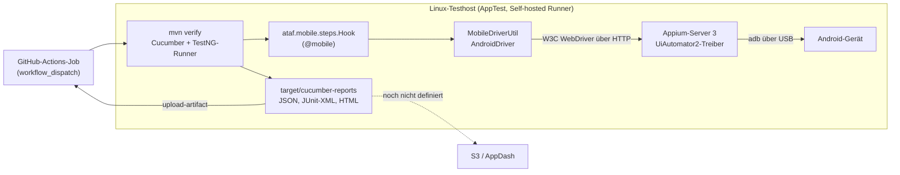

# Mobile-App-Tests (Android)

Das Modul `mobile` automatisiert native Android-Apps mit [Appium](https://appium.io/) und dem UiAutomator2-Treiber. Es hängt sich in denselben Cucumber-Lebenszyklus ein wie die Module `web` und `rest`: Versieh ein Szenario mit dem Tag `@mobile`, dann startet ATAF vor dem Szenario eine Appium-Session auf dem konfigurierten Gerät und beendet sie danach wieder.

::: warning Proof of Concept (ATAF-26)
Das Modul ist eine erste, bewusst kleine Umsetzung: nur Android, ein Gerät pro Host, Szenarien laufen nacheinander. Alles, was keine Hardware braucht, ist durch automatisierte Tests abgedeckt. Ein Lauf gegen ein physisches Gerät ist **noch nicht verifiziert**.
:::

## Umfang

| Abgedeckt                                                            | Noch nicht abgedeckt                                           |
| -------------------------------------------------------------------- | -------------------------------------------------------------- |
| Native Android-Apps über Appium 3 und UiAutomator2                   | iOS- und iPadOS-Apps, Safari auf iOS                           |
| Ein physisches Gerät (oder Emulator) pro Host, Szenarien sequenziell | Parallele Läufe auf mehreren Geräten, Device-Farmen            |
| Cucumber mit Feature-Dateien in Git, ohne Jira/Xray                  | Jira-/Xray- oder TestLink-Anbindung für mobile Läufe           |
| Cucumber-JSON-, JUnit-XML- und HTML-Reports, Maven-Exit-Status       | Übertragung nach S3/AppDash, Rückmeldung an auslösende Systeme |

## Architektur



| Klasse                               | Aufgabe                                                                                                           |
| ------------------------------------ | ----------------------------------------------------------------------------------------------------------------- |
| `ataf.mobile.config.MobileConfig`    | Liest und validiert die Properties `testautomation.mobile.*` und meldet alle Probleme auf einmal.                 |
| `ataf.mobile.utils.MobileDriverUtil` | Baut die UiAutomator2-Capabilities, startet und beendet die Appium-Session des aktuellen Threads.                 |
| `ataf.mobile.pages.MobileBasePage`   | Basisklasse für Page Objects: Locator, explizite Waits, Tippen, Texteingabe, Sichtbarkeitsprüfungen, Screenshots. |
| `ataf.mobile.steps.Hook`             | Cucumber-Hooks für Szenarien mit dem Tag `@mobile`.                                                               |

Was bei jedem Szenario mit `@mobile` passiert:

1. **Vor dem Szenario** liest der Hook die Konfiguration. Fehlende oder ungültige Werte lassen das Szenario mit einer Meldung fehlschlagen, die alle Probleme auflistet. Danach startet er die Appium-Session. Ist der Appium-Server nicht erreichbar oder lehnt er die Session ab, schlägt das Szenario mit einer Meldung fehl, die die wahrscheinliche Ursache nennt.
2. **Während des Szenarios** nutzen Step-Definitionen und Page Objects die Session über `MobileDriverUtil.getDriver()` oder `new MeinePage()`.
3. **Nach dem Szenario** bekommt ein fehlgeschlagenes Szenario einen Screenshot angehängt, bei aktiviertem `pageSourceOnFailure` zusätzlich die UI-Hierarchie. Die Anhänge erscheinen im JSON- und HTML-Report. Danach wird die Session beendet. Das Aufräumen wirft nie eine Exception, kann den ursprünglichen Fehler also weder verdecken noch ersetzen.

Szenarien ohne `@mobile`, zum Beispiel `@web`- oder `@rest`-Szenarien, bleiben unberührt. Es kann immer nur eine Appium-Session aktiv sein: Der Start einer zweiten Session aus einem anderen Thread schlägt mit einer klaren Meldung fehl, statt zwei Sessions um dasselbe Gerät konkurrieren zu lassen.

## Kompatibilität

Geprüft im November 2026:

| Komponente           | Version                                  | Hinweis                                                                                             |
| -------------------- | ---------------------------------------- | --------------------------------------------------------------------------------------------------- |
| Java                 | 21                                       | Wie alle ATAF-Module                                                                                |
| Appium-Java-Client   | `io.appium:java-client:11.0.0`           | Erfordert Appium-Server 3 oder neuer; hängt nur von `selenium-api` ab                               |
| Selenium-API         | 4.51.0                                   | Dieselbe Selenium-Version wie im Modul `web` (Root-Property `selenium.version`)                     |
| Appium-Server        | 3.x (aktuell stabil: 3.9.0)              | Braucht Node.js `^20.19`, `^22.12` oder `>=24`; bedient `/`, solange kein `--base-path` gesetzt ist |
| UiAutomator2-Treiber | 8.x (letzte Version für Appium 3: 8.7.3) | Treiber 9.x erfordert Appium 4, das noch im Beta-Stadium ist                                        |
| Android              | 8.0 (API-Level 26) oder neuer            | Vorausgesetzt vom UiAutomator2-Treiber ab 6.0                                                       |

## Installation

Füge das Modul neben `core` hinzu. `web` oder `rest` werden nicht benötigt.

```xml
<dependency>
    <groupId>de.muenchen.ataf</groupId>
    <artifactId>mobile</artifactId>
    <version>0.3.5-SNAPSHOT</version>
</dependency>
```

Das Artefakt `mobile` wird mit dem nächsten ATAF-Release veröffentlicht. Bis dahin führst du in diesem Repository `mvn install` aus, um die Version `0.3.5-SNAPSHOT` zu erhalten. Konfiguriere Surefire mit dem TestNG-Provider wie unter [Tests schreiben](./writing-tests.md#provider-konfiguration) beschrieben.

## Linux-Testhost vorbereiten

Das Gerät ist per USB mit dem Linux-Rechner verbunden, der die Tests ausführt (im Zielbild ein von AppTest betriebener ThinkCentre). Appium läuft auf demselben Rechner.

### Android SDK und USB-Zugriff

1. Installiere JDK 21 und Maven.
2. Installiere die Android-SDK-Command-Line-Tools von [developer.android.com](https://developer.android.com/studio#command-line-tools-only), danach die Platform-Tools und eine Build-Tools-Version:

   ```bash
   sdkmanager --sdk_root="$HOME/android-sdk" "platform-tools" "build-tools;35.0.0"
   ```

3. Exportiere den SDK-Pfad für den Benutzer, unter dem Appium läuft, zum Beispiel in `~/.profile`:

   ```bash
   export ANDROID_HOME="$HOME/android-sdk"
   export PATH="$ANDROID_HOME/platform-tools:$PATH"
   ```

4. Erlaube den USB-Zugriff auf das Gerät: Nimm den Benutzer in die Gruppe `plugdev` auf und installiere udev-Regeln für Android-Geräte (unter Debian und Ubuntu liefert das Paket `android-sdk-platform-tools-common` sie mit). Melde dich danach einmal ab und wieder an.

### Gerät

1. Aktiviere die Entwickleroptionen (in den Geräteeinstellungen siebenmal auf **Build-Nummer** tippen) und schalte **USB-Debugging** ein.
2. Schließe das Gerät an und bestätige die Abfrage des RSA-Fingerabdrucks mit **Von diesem Computer immer zulassen**.
3. Prüfe, dass das Gerät mit dem Status `device` aufgeführt ist (nicht `unauthorized` oder `offline`):

   ```bash
   adb devices -l
   ```

   Die erste Spalte ist die Seriennummer, die ATAF in `testautomation.mobile.udid` erwartet.

4. Halte das Gerät während der Testläufe wach (Entwickleroption **Aktiv lassen**) und entferne die Bildschirmsperre. Manche Hersteller brauchen zusätzliche Schalter, zum Beispiel _USB-Debugging (Sicherheitseinstellungen)_ und _Über USB installieren_ bei Xiaomi-Geräten.

### Appium-Server und UiAutomator2-Treiber

```bash
npm install -g appium@3.9.0
```

```bash
appium driver install uiautomator2@8.7.3
```

```bash
appium driver doctor uiautomator2
```

```bash
appium --address 127.0.0.1 --port 4723
```

`appium driver doctor uiautomator2` prüft `ANDROID_HOME`, `JAVA_HOME` und `adb`. Appium 2 und 3 bedienen den Root-Pfad. Startest du den Server mit `--base-path /wd/hub`, gehört der Pfad in `testautomation.mobile.appiumServerUrl`. ATAF ergänzt selbst nie einen Base-Path. Auf einem unbeaufsichtigten Host betreibst du Appium als Dienst unter dem Benutzer des Runners, mit gesetztem `ANDROID_HOME` und `JAVA_HOME`. Den Server prüfst du mit:

```bash
curl http://127.0.0.1:4723/status
```

## Konfiguration

Mobile Einstellungen stehen in `testautomation.properties` mit dem Präfix `testautomation.mobile.`. Jeder Wert lässt sich mit einer JVM-System-Property überschreiben, zum Beispiel `-Dtestautomation.mobile.udid=R5CT1234ABC`. Umgebungsvariablen liest ATAF nicht direkt. In der CI übergibst du sie auf der Maven-Kommandozeile als `-D`-Werte. Leere Werte gelten als nicht gesetzt, eine leere CI-Variable führt also zum Standardwert.

| Property (`testautomation.mobile.` + …) | Standard                | Beschreibung                                                                                                                                          |
| --------------------------------------- | ----------------------- | ----------------------------------------------------------------------------------------------------------------------------------------------------- |
| `appiumServerUrl`                       | `http://127.0.0.1:4723` | Vollständige URL des Appium-Servers, inklusive Base-Path, falls der Server einen verwendet.                                                           |
| `udid`                                  | –                       | Seriennummer des Geräts aus `adb devices`. Ohne sie verwendet Appium das einzige angeschlossene Gerät, und ATAF protokolliert eine Warnung.           |
| `platformName`                          | `Android`               | Nur `Android` wird akzeptiert.                                                                                                                        |
| `platformVersion`                       | –                       | Optionale Android-Version, die das Gerät haben muss, zum Beispiel `14`.                                                                               |
| `automationName`                        | `UiAutomator2`          | Appium-Treiber.                                                                                                                                       |
| `appPackage`                            | –                       | Package der zu testenden App. `appPackage` oder `app` ist Pflicht.                                                                                    |
| `appActivity`                           | –                       | Zu startende Activity, zum Beispiel `.MainActivity`. Optional.                                                                                        |
| `app`                                   | –                       | Pfad oder http(s)-URL einer zu installierenden APK. Relative Pfade werden zu absoluten aufgelöst und müssen auf dem Testhost existieren.              |
| `newCommandTimeoutSeconds`              | `120`                   | Wie lange Appium eine untätige Session offen hält, zum Beispiel nach einem abgebrochenen Lauf.                                                        |
| `explicitWaitSeconds`                   | `20`                    | Standard-Timeout der expliziten Waits in `MobileBasePage`.                                                                                            |
| `screenshotOnFailure`                   | `true`                  | Hängt fehlgeschlagenen Szenarien einen Screenshot an.                                                                                                 |
| `pageSourceOnFailure`                   | `false`                 | Hängt fehlgeschlagenen Szenarien die UI-Hierarchie (XML) an. Standardmäßig aus, weil sie Testdaten enthalten kann.                                    |
| `additionalCapabilities`                | –                       | Weitere Appium-Capabilities als JSON-Objekt, zuletzt angewendet. Namen ohne Vendor-Präfix bekommen `appium:`, zum Beispiel `{"appium:noReset":true}`. |

Beispiel:

```properties
testautomation.mobile.appiumServerUrl=http://127.0.0.1:4723
testautomation.mobile.appPackage=com.example.app
testautomation.mobile.appActivity=.MainActivity
testautomation.mobile.additionalCapabilities={"appium:autoGrantPermissions":true,"appium:uiautomator2ServerLaunchTimeout":60000}
```

Geräte-Seriennummern, interne Hostnamen und App-Pfade gehören in `-D`-Werte oder CI-Variablen, nicht ins Repository. Enthalten die zusätzlichen Capabilities Geheimnisse (zum Beispiel `appium:keystorePassword`), verwende das Präfix `testautomation.secret.mobile.additionalCapabilities`, damit der Wert nicht protokolliert wird. ATAF maskiert außerdem Passwort-, Secret-, Token- und Unlock-Key-Capabilities, wenn es die angeforderten Capabilities protokolliert.

## Mobile Tests schreiben

Versieh die Szenarien (oder das ganze Feature) mit dem Tag `@mobile` und nimm `ataf.mobile.steps` in den Glue auf:

```properties
cucumber.features=src/test/resources/features
cucumber.glue=ataf.mobile.steps,your.project.steps
cucumber.plugin=json:target/cucumber-reports/cucumber.json,junit:target/cucumber-reports/cucumber.xml,html:target/cucumber-reports/cucumber.html
```

```gherkin
@mobile
Feature: Login

  Scenario: Successful login
    Given the login screen is displayed
    When the user logs in as "demo"
    Then the start screen is displayed
```

Page Objects erben von `MobileBasePage`. Der Konstruktor ohne Argumente bindet die Page an die Session des aktuellen Szenarios:

```java
import ataf.mobile.pages.MobileBasePage;
import org.openqa.selenium.By;

public class LoginPage extends MobileBasePage {
    private static final By USER_NAME = resourceId("com.example.app:id/user_name");
    private static final By LOGIN = accessibilityId("Log in");

    public void logIn(String userName) {
        enterTextInElement(USER_NAME, userName);
        tapOnElement(LOGIN);
    }
}
```

- **Locator:** Bevorzuge `accessibilityId(...)` (die Android-Content-Description) und `resourceId(...)`. XPath ist auf Mobilgeräten langsam und bricht leicht.
- **Waits:** `waitForElementVisible`, `waitForElementClickable` und alle Interaktionen warten explizit. `isElementVisible` und `isElementPresent` prüfen sofort. Es gibt keine festen Sleeps und keine impliziten Waits.
- **Appium-Befehle:** `MobileDriverUtil.getDriver()` liefert den `AndroidDriver` für alles Weitere, zum Beispiel `getCurrentPackage()` oder `mobile:`-Extension-Befehle.
- **Runner:** Erbe von `BasicTestNGRunner`, nicht von `ParallelTestNGRunner`. Wie jeder ATAF-Runner braucht er `cucumber.features` und ein `json:`-Plugin in `cucumber.properties` sowie `taf.testDataEncryptionPassword` (siehe [Laufzeit-Zugangsdaten](../configuration/credentials.md)).

Das Modul [`examples/mobile-android-demo`](https://github.com/it-at-m/agile-test-automation-framework/tree/main/examples/mobile-android-demo) zeigt ein vollständiges Consumer-Setup mit der öffentlichen App [ApiDemos](https://www.npmjs.com/package/android-apidemos).

## Tests ausführen

| Zweck                                                 | Befehl                                                                                        |
| ----------------------------------------------------- | --------------------------------------------------------------------------------------------- |
| Unit-Tests des Moduls (ohne Gerät)                    | `mvn -pl mobile -am test`                                                                     |
| Smoke-Test auf einem Gerät (öffnet die Einstellungen) | `mvn -pl mobile -am test -Dataf.it.mobile.enabled=true -Dtestautomation.mobile.udid=<serial>` |
| Demo-Szenario auf einem Gerät                         | zwei Schritte, siehe [Demo-Szenario](#demo-szenario) weiter unten                             |
| Nur bestimmte Szenarien (Consumer-Projekte und Demo)  | zusätzlich `-Dcucumber.filter.tags="@mobile and @smoke"`                                      |

### Demo-Szenario

Lade die Demo-APK in einen Ordner außerhalb des Repositorys herunter, damit sie nicht versehentlich eingecheckt wird:

```bash
npm pack android-apidemos@5.0.0 && tar -xzf android-apidemos-5.0.0.tgz package/apks/ApiDemos-debug.apk
```

Installiere die Framework-Module einmal und erneut, nachdem du Framework-Code geändert hast:

```bash
mvn install -DskipTests
```

Führe danach nur das Demo-Modul aus:

```bash
mvn -pl examples/mobile-android-demo verify -Pandroid-device -Dtestautomation.mobile.udid=<serial> -Dtestautomation.mobile.app=<absoluter Pfad zur ApiDemos-debug.apk>
```

Ergänze hier kein `-am`: `-D`-Werte gelten für jedes Modul im Build, die Geräteeinstellungen würden also auch die Unit-Tests von `core` und `mobile` erreichen. Gib die APK als absoluten Pfad an, denn die Maven-Run-Configurations von IntelliJ lösen Shell-Variablen wie `$PWD` nicht auf. In PowerShell setzt du jedes `-D`-Argument in Anführungszeichen, zum Beispiel `"-Dtestautomation.mobile.udid=<serial>"`.

Gerätetests laufen nur auf ausdrücklichen Wunsch: Der Smoke-Test wird ohne `-Dataf.it.mobile.enabled=true` übersprungen, und das Demo-Szenario läuft nur mit dem Profil `android-device`. Normale Builds und Pull-Request-Checks brauchen kein Gerät.

Maven beendet sich mit `0`, wenn alle Szenarien bestehen. Mit einem Exit-Code ungleich 0 endet es, wenn ein Szenario fehlschlägt oder die Session nicht starten kann. Typische Meldungen:

- `Appium server is not reachable at [http://127.0.0.1:4723]…`: Appium läuft nicht, oder URL bzw. Base-Path sind falsch.
- `Appium could not create an Android session for device […]…`: Das Gerät fehlt in `adb devices` oder ist nicht autorisiert, die UDID ist falsch, der UiAutomator2-Treiber fehlt, oder App-Package, Activity bzw. APK stimmen nicht. Die Meldung endet mit der Erklärung von Appium selbst.
- `Invalid mobile configuration…`: listet alle fehlenden oder ungültigen Properties auf.

## Reports

| Datei                                   | Format                                            | Verwendung                                   |
| --------------------------------------- | ------------------------------------------------- | -------------------------------------------- |
| `target/cucumber-reports/cucumber.json` | Cucumber-JSON, Screenshots als Base64 eingebettet | Maschinenlesbare Ergebnisse für andere Tools |
| `target/cucumber-reports/cucumber.xml`  | JUnit-XML, ein Testfall pro Szenario              | CI-Dashboards                                |
| `target/cucumber-reports/cucumber.html` | Cucumber-HTML-Report                              | Ergebnisse lesen, Screenshots ansehen        |
| `target/surefire-reports/`              | TestNG- und JUnit-XML des Runners                 | Maven und CI                                 |
| `logs/<Szenario>.log`                   | Log je Szenario                                   | Fehlersuche                                  |

Die Report-Pfade stammen aus `cucumber.plugin` und lassen sich pro Lauf mit `-Dcucumber.plugin=…` ändern. Welches Format AppDash erwartet, ist noch nicht festgelegt. Als Quelle ist der Cucumber-JSON-Report vorgesehen. Sobald das Schema von AppDash bekannt ist, kann ein kleiner Transformationsschritt, der eventuell auch die eingebetteten Screenshots extrahiert, ihn vor dem Upload nach S3 in dieses Format bringen.

## GitHub Actions

GitHub-gehostete Runner erreichen kein USB-Gerät, Geräteläufe brauchen daher einen **Self-hosted Runner** auf dem Linux-Host, an dem das Gerät hängt. Die Vorlage [`examples/mobile-android-demo/github-actions/android-device-tests.yml`](https://github.com/it-at-m/agile-test-automation-framework/blob/main/examples/mobile-android-demo/github-actions/android-device-tests.yml) ist in diesem Repository inaktiv. Kopiere sie in das Repository, dem der Runner gehört, zum Beispiel das Test-Repository, das AppTest ausführt. Sie:

- wird manuell gestartet (`workflow_dispatch`), mit optionalen Eingaben für Geräte-Seriennummer, Appium-URL und Cucumber-Tags; als Fallback dienen die Repository-Variablen `ANDROID_UDID` und `APPIUM_SERVER_URL`;
- läuft auf `[self-hosted, linux, android]` und erlaubt pro Gerät nur einen Lauf gleichzeitig;
- prüft vor den Tests `adb` und den Appium-Endpunkt `/status`, lädt die Demo-APK herunter und startet Maven;
- lädt `cucumber-reports/`, `surefire-reports/` und `logs/` als Artefakt hoch, auch wenn Tests fehlschlagen.

Der Job schlägt fehl, wenn ein Szenario fehlschlägt. Der Status des Laufs in GitHub ist damit das Ergebnis der Testausführung.

::: warning Self-hosted Runner und öffentliche Repositories
Registriere den Geräte-Runner nicht für ein öffentliches Repository: Pull Requests aus Forks könnten Code auf ihm ausführen. Lege den Geräte-Workflow in ein privates Repository oder beschränke den Runner über eine Runner-Gruppe auf dieses Repository.
:::

## Einschränkungen

- Ein Gerät und eine Session gleichzeitig. Eine zweite, parallele Session wird abgelehnt.
- APK-Pfade müssen auf dem Rechner existieren, der die Tests ausführt; im Proof of Concept läuft Appium auf demselben Rechner.
- Nur Android, keine iOS-Unterstützung.
- Der Lauf auf einem physischen Gerät ist noch nicht verifiziert.
- `java-client` 11 erschien im Oktober 2026 und hat die HTTP-Schicht von Selenium ersetzt; es gibt daher noch wenig Praxiserfahrung damit.

## Offene Integrationsarbeit

| Thema                                           | Stand                                                                                                                           |
| ----------------------------------------------- | ------------------------------------------------------------------------------------------------------------------------------- |
| Auslöser bei App-Updates (AppScan oder AppDash) | Nicht definiert. GitHub bietet `workflow_dispatch` über die REST-API oder `repository_dispatch`-Events.                         |
| Ausführung durch AppTest                        | Nicht festgelegt, ob AppTest als Self-hosted Runner registriert wird oder eine eigene API anbietet, die GitHub Actions aufruft. |
| Übertragung der Ergebnisse nach S3 und AppDash  | Bucket, Zugangsdaten, Dateiablage und das AppDash-Schema sind offen. Cucumber-JSON-Report und Screenshots liegen vor.           |
| Status zurück an die auslösende Pipeline        | Nicht definiert. Status des GitHub-Laufs und das Report-Artefakt liegen vor.                                                    |
| Mehrere Geräte parallel                         | Nicht Teil des Proof of Concept. Braucht eine Session pro Gerät mit eigenen UiAutomator2-Ports und eine Gerätezuordnung.        |
| iOS                                             | Nicht Teil des Proof of Concept.                                                                                                |
