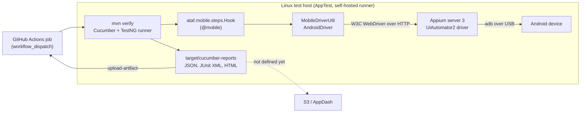

# Mobile App Testing (Android)

The `mobile` module automates native Android apps with [Appium](https://appium.io/) and the UiAutomator2 driver. It plugs into the same Cucumber lifecycle as the `web` and `rest` modules: tag a scenario with `@mobile`, and ATAF starts an Appium session on the configured device before the scenario and closes it afterwards.

::: warning Proof of concept (ATAF-26)
The module is a first, deliberately small implementation: Android only, one device per host, scenarios run one after another. All behaviour that doesn't need hardware is covered by automated tests. The device smoke test and the demo scenario have passed on a **Sony Xperia XZ Premium (Android 9)** connected to a Windows 11 PC, with Appium 3.9.0 and UiAutomator2 8.7.3. The Linux test host and runs through a GitHub self-hosted runner haven't been tested yet.
:::

## Scope

| Covered                                                          | Not covered yet                                         |
| ---------------------------------------------------------------- | ------------------------------------------------------- |
| Native Android apps via Appium 3 and UiAutomator2                | iOS and iPadOS apps, Safari on iOS                      |
| One physical device (or emulator) per host, sequential scenarios | Parallel runs across several devices, device farms      |
| Cucumber with feature files in Git, without Jira/Xray            | Jira/Xray or TestLink integration for mobile runs       |
| Cucumber JSON, JUnit XML and HTML reports, Maven exit status     | Transfer to S3/AppDash, callbacks to triggering systems |

## Architecture



| Class                                | Responsibility                                                                                          |
| ------------------------------------ | ------------------------------------------------------------------------------------------------------- |
| `ataf.mobile.config.MobileConfig`    | Reads and validates the `testautomation.mobile.*` properties and reports all problems at once.          |
| `ataf.mobile.utils.MobileDriverUtil` | Builds the UiAutomator2 capabilities, starts and closes the Appium session of the current thread.       |
| `ataf.mobile.pages.MobileBasePage`   | Base class for page objects: locators, explicit waits, tap, text entry, visibility checks, screenshots. |
| `ataf.mobile.steps.Hook`             | Cucumber hooks for scenarios tagged with `@mobile`.                                                     |

What happens for every scenario tagged with `@mobile`:

1. **Before the scenario** the hook reads the configuration. Missing or invalid values fail the scenario with one message listing every problem. Then it starts the Appium session. If the Appium server is unreachable or rejects the session, the scenario fails with a message that names the likely cause.
2. **During the scenario** step definitions and page objects use the session through `MobileDriverUtil.getDriver()` or `new MyPage()`.
3. **After the scenario** a failed scenario gets a screenshot attached, plus the UI hierarchy if `pageSourceOnFailure` is enabled. The attachments appear in the JSON and HTML reports. Then the session is closed. Cleanup never throws, so it can't hide or replace the original failure.

Scenarios without `@mobile`, for example `@web` or `@rest` scenarios, are not touched. Only one Appium session can be active at a time: starting a second one from another thread fails with a clear message instead of two sessions competing for the same device.

## Compatibility

Checked in November 2026:

| Component           | Version                          | Note                                                                               |
| ------------------- | -------------------------------- | ---------------------------------------------------------------------------------- |
| Java                | 21                               | Same as all ATAF modules                                                           |
| Appium Java client  | `io.appium:java-client:11.0.0`   | Requires Appium server 3 or newer; depends only on `selenium-api`                  |
| Selenium API        | 4.51.0                           | Same Selenium version as the `web` module (root property `selenium.version`)       |
| Appium server       | 3.x (latest stable: 3.9.0)       | Needs Node.js `^20.19`, `^22.12` or `>=24`; serves on `/` unless `--base-path` set |
| UiAutomator2 driver | 8.x (latest for Appium 3: 8.7.3) | Driver 9.x requires Appium 4, which is still in beta                               |
| Android             | 8.0 (API level 26) or newer      | Required by UiAutomator2 driver 6.0 and newer                                      |

## Installation

Add the module next to `core`. It does not need `web` or `rest`.

```xml
<dependency>
    <groupId>de.muenchen.ataf</groupId>
    <artifactId>mobile</artifactId>
    <version>0.3.5-SNAPSHOT</version>
</dependency>
```

The `mobile` artifact is published with the next ATAF release. Until then, run `mvn install` in this repository to get the `0.3.5-SNAPSHOT` version. Configure Surefire with the TestNG provider as described in [Writing Tests](./writing-tests.md#provider-configuration).

## Prepare the Linux test host

The device is connected by USB to the Linux machine that runs the tests (in the target setup a ThinkCentre operated by AppTest). Appium runs on the same machine.

### Android SDK and USB access

1. Install JDK 21 and Maven.
2. Install the Android SDK command-line tools from [developer.android.com](https://developer.android.com/studio#command-line-tools-only), then the platform tools and a build-tools version:

   ```bash
   sdkmanager --sdk_root="$HOME/android-sdk" "platform-tools" "build-tools;35.0.0"
   ```

3. Export the SDK location for the user that runs Appium, for example in `~/.profile`:

   ```bash
   export ANDROID_HOME="$HOME/android-sdk"
   export PATH="$ANDROID_HOME/platform-tools:$PATH"
   ```

4. Allow USB access to the device: add the user to the `plugdev` group and install udev rules for Android devices (on Debian and Ubuntu the package `android-sdk-platform-tools-common` provides them). Log out and in again afterwards.

### Device

1. Enable the developer options (tap **Build number** seven times in the device settings) and switch on **USB debugging**.
2. Connect the device and confirm the RSA fingerprint prompt with **Always allow from this computer**.
3. Check that the device is listed with the state `device` (not `unauthorized` or `offline`):

   ```bash
   adb devices -l
   ```

   The first column is the serial that ATAF expects in `testautomation.mobile.udid`.

4. Keep the device awake during test runs (developer option **Stay awake**) and remove the screen lock. Some vendors need extra switches, for example _USB debugging (Security settings)_ and _Install via USB_ on Xiaomi devices.

### Appium server and UiAutomator2 driver

```bash
npm install -g appium@3.9.0
```

```bash
appium driver install uiautomator2@8.7.3
```

```bash
appium driver doctor uiautomator2
```

```bash
appium --address 127.0.0.1 --port 4723
```

`appium driver doctor uiautomator2` checks `ANDROID_HOME`, `JAVA_HOME` and `adb`. Appium 2 and 3 serve on the root path. If you start the server with `--base-path /wd/hub`, include the path in `testautomation.mobile.appiumServerUrl`. ATAF never adds a base path itself. On an unattended host, run Appium as a service under the runner's user, with `ANDROID_HOME` and `JAVA_HOME` set. Check the server with:

```bash
curl http://127.0.0.1:4723/status
```

## Configuration

Mobile settings live in `testautomation.properties` with the prefix `testautomation.mobile.`. Every value can be overridden with a JVM system property, for example `-Dtestautomation.mobile.udid=R5CT1234ABC`. ATAF does not read environment variables directly. In CI, pass them on the Maven command line as `-D` values. Blank values count as unset, so an empty CI variable falls back to the default.

| Property (`testautomation.mobile.` + …) | Default                 | Description                                                                                                                                     |
| --------------------------------------- | ----------------------- | ----------------------------------------------------------------------------------------------------------------------------------------------- |
| `appiumServerUrl`                       | `http://127.0.0.1:4723` | Full URL of the Appium server, including the base path if the server uses one.                                                                  |
| `udid`                                  | –                       | Device serial from `adb devices`. Without it, Appium uses the only connected device and ATAF logs a warning.                                    |
| `platformName`                          | `Android`               | Only `Android` is accepted.                                                                                                                     |
| `platformVersion`                       | –                       | Optional Android version the device must have, for example `14`.                                                                                |
| `automationName`                        | `UiAutomator2`          | Appium driver.                                                                                                                                  |
| `appPackage`                            | –                       | Package of the app under test. `appPackage` or `app` is required.                                                                               |
| `appActivity`                           | –                       | Activity to launch, for example `.MainActivity`. Optional.                                                                                      |
| `app`                                   | –                       | Path or http(s) URL of an APK to install. Relative paths are resolved to absolute ones and must exist on the test host.                         |
| `newCommandTimeoutSeconds`              | `120`                   | How long Appium keeps an idle session open, for example after an aborted run.                                                                   |
| `explicitWaitSeconds`                   | `20`                    | Default timeout of the explicit waits in `MobileBasePage`.                                                                                      |
| `screenshotOnFailure`                   | `true`                  | Attach a screenshot to failed scenarios.                                                                                                        |
| `pageSourceOnFailure`                   | `false`                 | Attach the UI hierarchy (XML) to failed scenarios. Off by default because it can contain test data.                                             |
| `additionalCapabilities`                | –                       | Further Appium capabilities as a JSON object, applied last. Names without a vendor prefix get `appium:`, for example `{"appium:noReset":true}`. |

Example:

```properties
testautomation.mobile.appiumServerUrl=http://127.0.0.1:4723
testautomation.mobile.appPackage=com.example.app
testautomation.mobile.appActivity=.MainActivity
testautomation.mobile.additionalCapabilities={"appium:autoGrantPermissions":true,"appium:uiautomator2ServerLaunchTimeout":60000}
```

Device serials, internal host names and app paths belong in `-D` values or CI variables, not in the repository. If additional capabilities contain secrets (for example `appium:keystorePassword`), use the prefix `testautomation.secret.mobile.additionalCapabilities` so the value is not logged. ATAF also masks password, secret, token and unlock-key capabilities when it logs the requested capabilities.

## Writing mobile tests

Tag the scenarios (or the whole feature) with `@mobile` and add `ataf.mobile.steps` to the glue:

```properties
cucumber.features=src/test/resources/features
cucumber.glue=ataf.mobile.steps,your.project.steps
cucumber.plugin=json:target/cucumber-reports/cucumber.json,junit:target/cucumber-reports/cucumber.xml,html:target/cucumber-reports/cucumber.html
```

```gherkin
@mobile
Feature: Login

  Scenario: Successful login
    Given the login screen is displayed
    When the user logs in as "demo"
    Then the start screen is displayed
```

Page objects extend `MobileBasePage`. The no-argument constructor binds the page to the session of the current scenario:

```java
import ataf.mobile.pages.MobileBasePage;
import org.openqa.selenium.By;

public class LoginPage extends MobileBasePage {
    private static final By USER_NAME = resourceId("com.example.app:id/user_name");
    private static final By LOGIN = accessibilityId("Log in");

    public void logIn(String userName) {
        enterTextInElement(USER_NAME, userName);
        tapOnElement(LOGIN);
    }
}
```

- **Locators:** prefer `accessibilityId(...)` (the Android content description) and `resourceId(...)`. XPath is slow and breaks easily on mobile.
- **Waits:** `waitForElementVisible`, `waitForElementClickable` and all interactions wait explicitly. `isElementVisible` and `isElementPresent` check immediately. There are no fixed sleeps and no implicit waits.
- **Lists:** Android only includes the rows of a list that are on screen in the UI hierarchy, so an entry further down can't be found yet. `scrollToAccessibilityId(...)` scrolls the first scrollable container until the entry is displayed and returns it.
- **Appium commands:** `MobileDriverUtil.getDriver()` returns the `AndroidDriver` for everything else, for example `getCurrentPackage()` or `mobile:` extension commands.
- **Runner:** extend `BasicTestNGRunner`, not `ParallelTestNGRunner`. Like every ATAF runner, it needs `cucumber.features` and a `json:` plugin in `cucumber.properties`, plus `taf.testDataEncryptionPassword` (see [Runtime Credentials](../configuration/credentials.md)).

The [`examples/mobile-android-demo`](https://github.com/it-at-m/agile-test-automation-framework/tree/main/examples/mobile-android-demo) module shows a complete consumer setup with the public [ApiDemos](https://www.npmjs.com/package/android-apidemos) app.

## Running the tests

| Purpose                                          | Command                                                                                       |
| ------------------------------------------------ | --------------------------------------------------------------------------------------------- |
| Unit tests of the module (no device needed)      | `mvn -pl mobile -am test`                                                                     |
| Smoke test on a device (opens the Settings app)  | `mvn -pl mobile -am test -Dataf.it.mobile.enabled=true -Dtestautomation.mobile.udid=<serial>` |
| Demo scenario on a device                        | two steps, see [Demo scenario](#demo-scenario) below                                          |
| Only some scenarios (consumer projects and demo) | add `-Dcucumber.filter.tags="@mobile and @smoke"`                                             |

### Demo scenario

Download the demo APK into a folder outside the repository, so it can't be committed by accident:

```bash
npm pack android-apidemos@5.0.0 && tar -xzf android-apidemos-5.0.0.tgz package/apks/ApiDemos-debug.apk
```

Install the framework modules once, and again after you change framework code:

```bash
mvn install -DskipTests
```

Then run only the demo module:

```bash
mvn -pl examples/mobile-android-demo verify -Pandroid-device -Dtestautomation.mobile.udid=<serial> -Dtestautomation.mobile.app=<absolute path to ApiDemos-debug.apk>
```

Don't add `-am` here: `-D` values apply to every module in the build, so the device settings would also reach the unit tests of `core` and `mobile`. Pass the APK as an absolute path, because IntelliJ's Maven run configurations don't expand shell variables such as `$PWD`. In PowerShell, quote each `-D` argument, for example `"-Dtestautomation.mobile.udid=<serial>"`.

Device tests are opt-in: the smoke test is skipped without `-Dataf.it.mobile.enabled=true`, and the demo scenario only runs with the `android-device` profile. Regular builds and pull-request checks don't need a device.

Maven exits with `0` when all scenarios pass. It exits with a non-zero code when a scenario fails or the session can't be started. Typical messages:

- `Appium server is not reachable at [http://127.0.0.1:4723]…`: Appium isn't running or the URL or base path is wrong.
- `Appium could not create an Android session for device […]…`: the device is missing or unauthorised in `adb devices`, the UDID is wrong, the UiAutomator2 driver is missing, or the app package, activity or APK is wrong. The message ends with Appium's own explanation.
- `Invalid mobile configuration…`: lists every property that is missing or invalid.

## Reports

| File                                    | Format                                        | Use                                      |
| --------------------------------------- | --------------------------------------------- | ---------------------------------------- |
| `target/cucumber-reports/cucumber.json` | Cucumber JSON, screenshots embedded as Base64 | Machine-readable results for other tools |
| `target/cucumber-reports/cucumber.xml`  | JUnit XML, one test case per scenario         | CI dashboards                            |
| `target/cucumber-reports/cucumber.html` | Cucumber HTML report                          | Reading results, viewing screenshots     |
| `target/surefire-reports/`              | TestNG and JUnit XML of the runner            | Maven and CI                             |
| `logs/<scenario>.log`                   | Log of each scenario                          | Debugging                                |

The report paths come from `cucumber.plugin` and can be changed per run with `-Dcucumber.plugin=…`. The format AppDash expects is not defined yet. The Cucumber JSON report is the intended source. Once AppDash's schema is known, a small transformation step, which may also extract the embedded screenshots, can turn it into that format before it is uploaded to S3.

## GitHub Actions

GitHub-hosted runners can't reach a USB device, so device runs need a **self-hosted runner** on the Linux host the device is connected to. The template [`examples/mobile-android-demo/github-actions/android-device-tests.yml`](https://github.com/it-at-m/agile-test-automation-framework/blob/main/examples/mobile-android-demo/github-actions/android-device-tests.yml) is inactive in this repository. Copy it into the repository that owns the runner, for example the test repository that AppTest executes. It:

- is started manually (`workflow_dispatch`) with optional inputs for the device serial, the Appium URL and the Cucumber tags, falling back to the repository variables `ANDROID_UDID` and `APPIUM_SERVER_URL`;
- runs on `[self-hosted, linux, android]` and allows only one run per device at a time;
- checks `adb` and the Appium `/status` endpoint before the tests, downloads the demo APK and runs Maven;
- uploads `cucumber-reports/`, `surefire-reports/` and `logs/` as an artifact, even when tests fail.

The job fails when a scenario fails, so the run status in GitHub is the result of the test execution.

::: warning Self-hosted runners and public repositories
Don't register the device runner for a public repository: pull requests from forks could run code on it. Keep the device workflow in a private repository, or limit the runner to that repository through a runner group.
:::

## Limitations

- One device and one session at a time. A second, parallel session is rejected.
- APK paths must exist on the machine that runs the tests; in the proof of concept Appium runs on the same machine.
- Android only; no iOS support.
- Verified on one device so far (Sony Xperia XZ Premium, Android 9, on Windows 11). The Linux test host and the GitHub self-hosted runner haven't been tested yet.
- `java-client` 11 was released in October 2026 and replaced Selenium's HTTP layer, so there is little field experience with it so far.

## Remaining integration work

| Topic                                   | Status                                                                                                                      |
| --------------------------------------- | --------------------------------------------------------------------------------------------------------------------------- |
| App update trigger (AppScan or AppDash) | Not defined. GitHub offers `workflow_dispatch` via the REST API or `repository_dispatch` events.                            |
| Execution by AppTest                    | Not defined whether AppTest is registered as a self-hosted runner or provides its own API that GitHub Actions calls.        |
| Result transfer to S3 and AppDash       | Bucket, credentials, file layout and the AppDash schema are open. The Cucumber JSON report and screenshots are available.   |
| Status back to the triggering pipeline  | Not defined. The GitHub run status and the report artifact are available.                                                   |
| Several devices in parallel             | Out of scope for the proof of concept. Needs one session per device with separate UiAutomator2 ports and device assignment. |
| iOS                                     | Out of scope for the proof of concept.                                                                                      |
